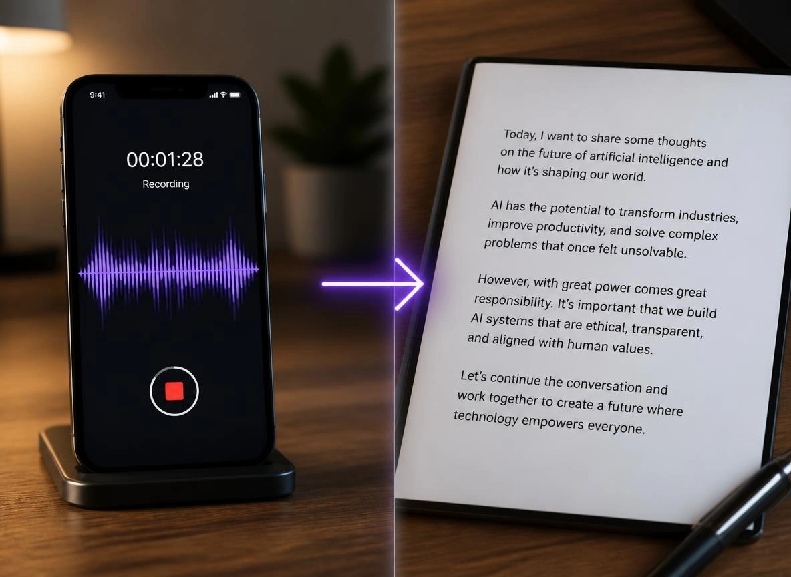

  
  <h1>Dapple</h1>
  
<strong>Handy AI tools for photos, audio, and documents.</strong>

  
Choose the tools you need. Your files are processed on your phone.

  
   
  <a href="https://xenevastudio.github.io/privacy.html">Privacy policy</a>

## Available tools

### Photos

- **Background Remover** — remove a photo background and save the result as a transparent PNG.
- **Photo Enhancer** — enlarge photos up to 4× and bring out more detail.
- **Object Remover** — paint over unwanted objects and fill the selected area.
- **Photo Restoration** — repair scratches, colorize old black-and-white photos, and improve detail.

### Audio and speech

- **Speech Noise Remover** — reduce background noise in recordings and save the cleaned audio as WAV.
- **Speech-to-Text** — transcribe recordings in 15 common languages or use automatic language detection. Review and edit the transcript, then copy, share, or save it as a text file. Recordings up to five minutes are supported.

### Documents

- **Document Scanner & OCR** — scan with the camera or import photos, adjust pages, and recognize English or German text. Arrange pages and export searchable PDFs or text files.

Audio file support can vary by device. Speech tools accept WAV, MP3, M4A, FLAC, and OGG where the phone can decode them.

## Designed for your phone

- **Private by design:** selected photos, recordings, and documents are processed on your device and are not uploaded for processing.
- **Download tools when needed:** model files are downloaded only when you choose a tool. Once downloaded, its model can be used offline.
- **Manage storage:** view and remove downloaded models from Dapple's Downloads and Settings screens.
- **Works across devices:** processing speed and results depend on your phone and the selected file. Large photos may be resized to fit available memory.

## A look at Dapple

<table>
  <tr>
    <td align="center"></td>
    <td align="center"></td>
    <td align="center"></td>
  </tr>
  <tr>
    <td align="center"><strong>Background Remover</strong></td>
    <td align="center"><strong>Photo Enhancer</strong></td>
    <td align="center"><strong>Object Remover</strong></td>
  </tr>
  <tr>
    <td align="center"></td>
    <td align="center"></td>
    <td align="center"></td>
  </tr>
  <tr>
    <td align="center"><strong>Photo Restoration</strong></td>
    <td align="center"><strong>Speech Noise Remover</strong></td>
    <td align="center"><strong>Document Scanner &amp; OCR</strong></td>
  </tr>
  <tr>
    <td align="center"></td>
    <td></td>
    <td></td>
  </tr>
  <tr>
    <td align="center"><strong>Speech-to-Text</strong></td>
    <td></td>
    <td></td>
  </tr>
</table>

## Coming soon

- Offline Translator
- Video Background Remover
- Video Enhancer

  Made by <a href="https://xenevastudio.github.io/">Xeneva Studio</a> · <a href="https://play.google.com/store/apps/details?id=com.xenevastudio.dapple&hl=en">Get Dapple on Google Play</a>

