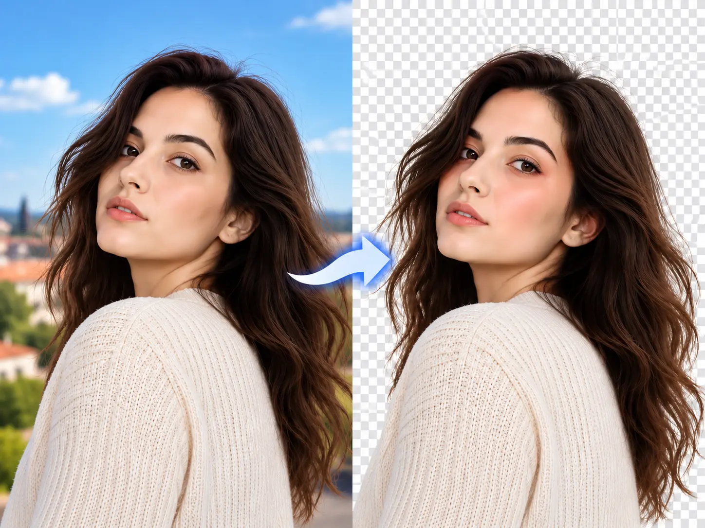
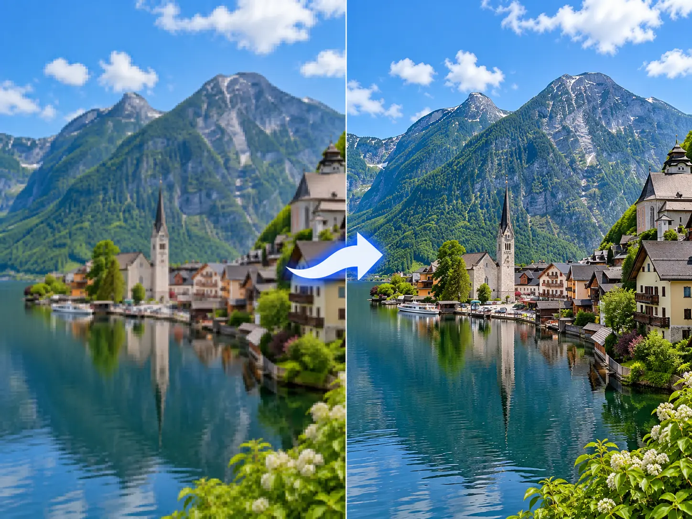
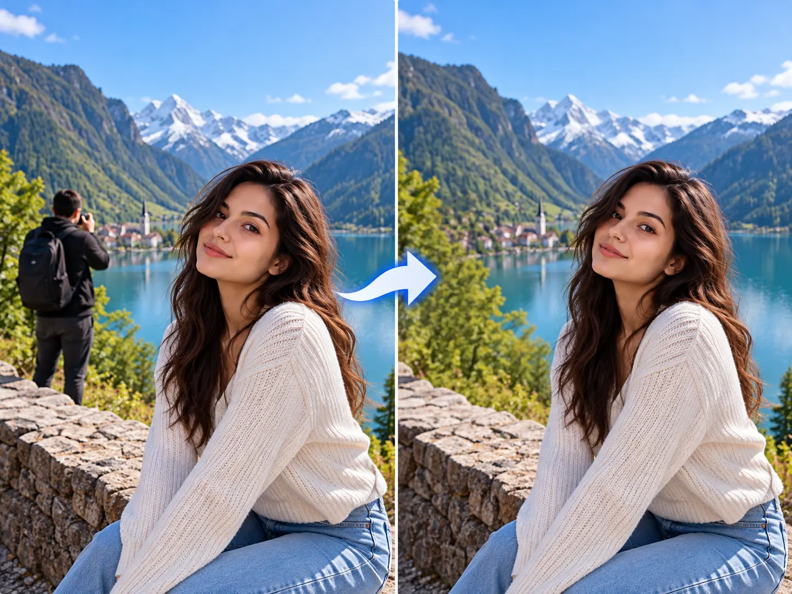
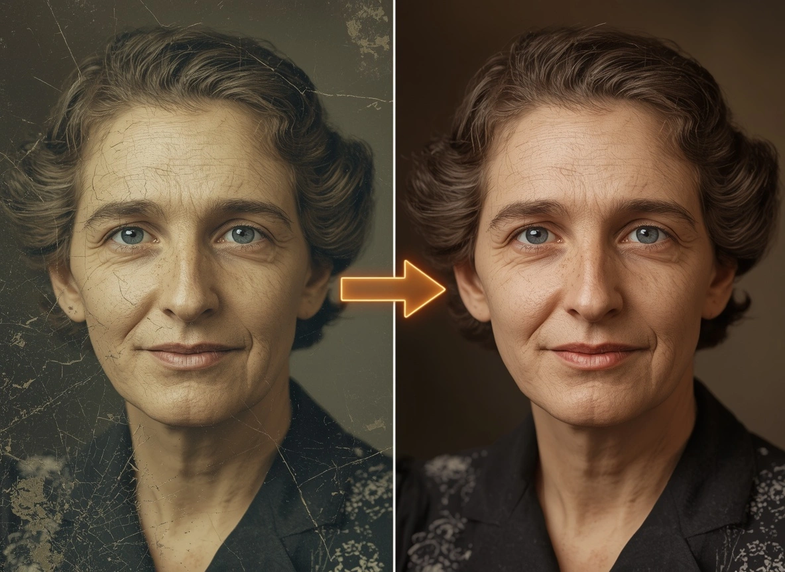
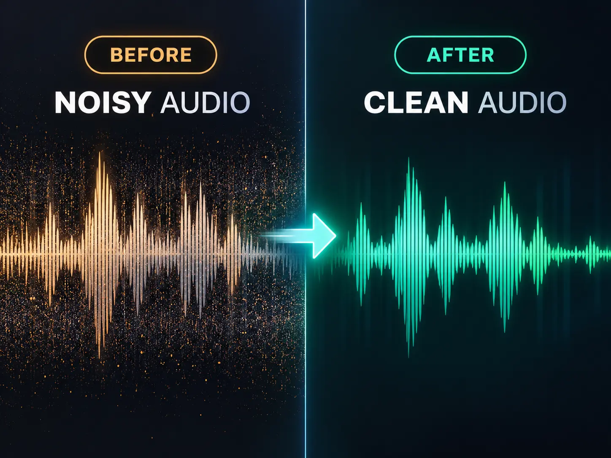
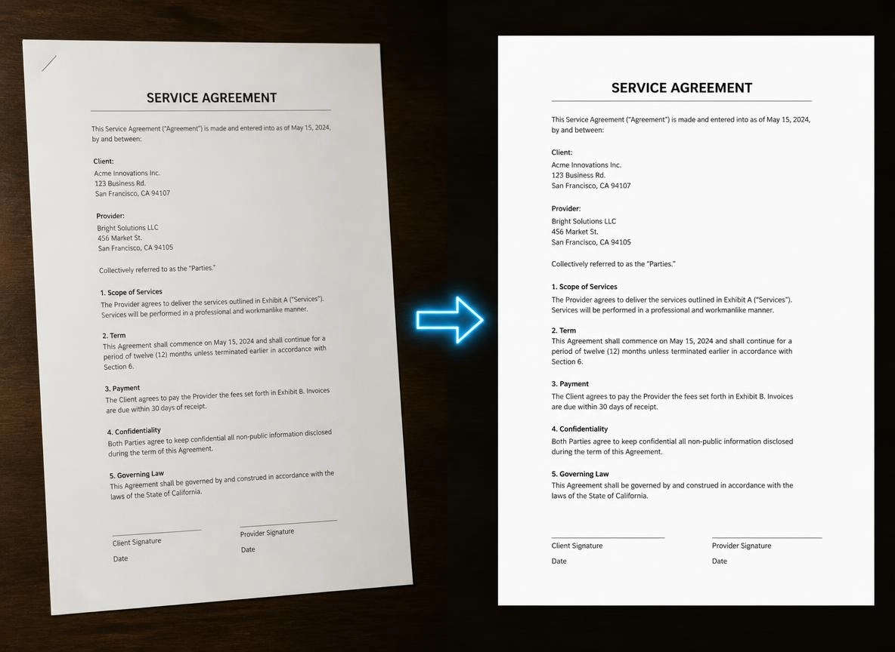

  
  <h1>Dapple</h1>
  
<strong>Useful AI tools for photos, audio, and documents — right on your phone.</strong>

  
Your files stay on your device while tools work. Download each tool when you need it.

  
   
  <a href="https://xenevastudio.github.io/privacy.html">Privacy policy</a>

## What you can do

### Photos

- **Background Remover** — remove a photo background and save a transparent PNG.
- **Photo Enhancer** — increase photo size and bring out more detail.
- **Object Remover** — paint over something you want gone and clean it from the photo.
- **Photo Restoration** — repair damaged photos, restore color, and improve detail.

### Audio and speech

- **Speech Noise Remover** — make voices easier to hear by reducing background noise.
- **Speech-to-Text** — turn recordings into editable text, with language selection and automatic detection.

### Documents

- **Document Scanner & OCR** — capture or import pages, adjust their edges, and recognize English or German text offline. Arrange pages and export searchable PDFs or text files.

## A look at Dapple

<table>
  <tr>
    <td align="center"></td>
    <td align="center"></td>
    <td align="center"></td>
  </tr>
  <tr>
    <td align="center"><strong>Background Remover</strong></td>
    <td align="center"><strong>Photo Enhancer</strong></td>
    <td align="center"><strong>Object Remover</strong></td>
  </tr>
  <tr>
    <td align="center"></td>
    <td align="center"></td>
    <td align="center"></td>
  </tr>
  <tr>
    <td align="center"><strong>Photo Restoration</strong></td>
    <td align="center"><strong>Speech Noise Remover</strong></td>
    <td align="center"><strong>Document Scanner &amp; OCR</strong></td>
  </tr>
</table>

## Coming soon

- Offline Translator
- Video Background Remover
- Video Enhancer

  Made by <a href="https://xenevastudio.github.io/">Xeneva Studio</a> · <a href="https://play.google.com/store/apps/details?id=com.xenevastudio.dapple&hl=en">Get Dapple on Google Play</a>

